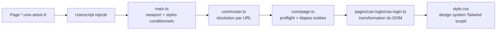

<div align="center">

# 🎨 Artois University Rebranding

**Redonner un coup de jeune à l'ENT de l'Université d'Artois, sans toucher au serveur.**

Un userscript qui modernise l'interface du SSO CAS et, à terme, l'ensemble du portail uPortal.

[](.github/workflows/ci.yml)
[](https://bun.sh)
[](https://www.typescriptlang.org/)
[](https://vite.dev/)
[](https://tailwindcss.com/)
[](#démarrage-rapide)
[](#roadmap)
[](LICENSE)

[Le projet](#le-projet) · [Fonctionnalités](#fonctionnalités) · [Démarrage rapide](#démarrage-rapide) · [Roadmap](#roadmap) · [Licence](#licence)

</div>

> [!WARNING]
> **Projet non officiel.** Ce projet n'est ni affilié, ni approuvé par l'Université d'Artois. Le nom, le logo et l'identité visuelle de l'université appartiennent à l'établissement. Le userscript ne collecte aucun identifiant et ne modifie que le DOM côté client. Vérifie la charte informatique de l'université avant de l'utiliser.

## Le projet

L'ENT (Environnement Numérique de Travail) de l'Université d'Artois repose sur une pile historique : **CAS** pour l'authentification, **uPortal** pour le portail, et plusieurs applications métiers (Moodle, ADE, webmail, etc.). L'interface actuelle est fonctionnelle mais datée : tables HTML, images de fond, polices de 10 px, absence de responsive.

Plutôt que de modifier le serveur, ce projet injecte une **couche de présentation** via un userscript :

- aucun changement côté serveur ;
- aucune donnée d'authentification interceptée ;
- un design system centralisé, facile à faire évoluer ;
- des tests unitaires sur des fixtures HTML réelles.

**État actuel :** version `0.1.0`, page de connexion CAS rebrandée. Les autres pages restent à inventorier avant toute implémentation.

**Ligne directrice :** moderniser les éléments déjà présents sans ajouter de fonctionnalités, de liens ou de contenu propres au userscript. Les adaptations nécessaires à l'accessibilité font exception.

**Périmètre actuel :** le userscript est injecté sur `https://*.univ-artois.fr/*`, mais il ne modifie que les pages déclarées dans `src/pages/index.ts`. Seule la page de connexion CAS est prise en charge pour l'instant ; les autres pages sont ignorées sans effet de bord.

| Élément                    | Statut | Détail                                                           |
| -------------------------- | :----: | ---------------------------------------------------------------- |
| Connexion CAS `/cas/login` |   ✅   | Header, logo, champs, aides contextuelles, alerte, footer        |
| Responsive mobile          |   ✅   | Injection d'un meta viewport                                     |
| Design system              |   ✅   | Palette, Inter, composants de base, icônes Papicons (sprite)     |
| Tests                      |   ✅   | Tests sur la page CAS, le cœur du script et les helpers partagés |
| CI                         |   ✅   | Lint, format, typecheck, tests, build                            |
| Reste de l'ENT             |   ⬜   | Voir la [roadmap](#roadmap)                                      |

## Aperçu

| Avant                                 | Après                                    |
| ------------------------------------- | ---------------------------------------- |
| Table HTML 780×560 avec image de fond | Carte blanche responsive, coins arrondis |
| Police Verdana 10 px                  | Inter, tailles lisibles                  |
| Champs sans labels explicites         | Labels, icônes, champs accessibles       |
| Bouton image                          | Bouton orange accessible                 |
| Erreur brute dans `#status`           | Alerte `alert-error` stylée              |
| Pas de viewport mobile                | Meta viewport injectée                   |
| Footer sécurité en petits caractères  | Bloc d'information lisible               |

## Fonctionnalités

- 🎨 **Rebranding du login CAS** — header avec logo, champs accessibles, bouton orange, alerte d'erreur, footer de sécurité.
- 📱 **Responsive** — injection d'un meta viewport et mise en page adaptative.
- ♿ **Accessibilité** — labels explicites, aides contextuelles accessibles, focus visible, animations réduites et erreurs annoncées. La conformité globale RGAA / WCAG AA reste à auditer.
- 🧩 **Design system** — palette, composants et sprite d'icônes Papicons.
- 🧩 **Templates TSX** — blocs HTML décrits comme composants Preact et rendus en chaîne.
- 🧪 **Tests** — fixtures HTML réelles et tests Vitest/jsdom.
- ⚙️ **CI** — lint, format, typecheck, tests et build sur GitHub Actions.
- 🔒 **Vie privée** — aucune collecte d'identifiants, aucune télémétrie.
- 🧱 **Architecture par page** — un registre de pages, un routeur par URL, un preflight, une garde d'idempotence et des étapes isolées : une erreur décorative ne bloque pas le reste du formulaire.

## Stack technique

| Outil                                                                                                                | Rôle                                |
| -------------------------------------------------------------------------------------------------------------------- | ----------------------------------- |
| [Bun](https://bun.sh) 1.4.2                                                                                          | Gestionnaire de paquets et runtime  |
| [Vite](https://vite.dev) 8                                                                                           | Bundler et serveur de développement |
| [TypeScript](https://www.typescriptlang.org) 6                                                                       | Typage strict                       |
| [Tailwind CSS](https://tailwindcss.com) 4.3                                                                          | Design system, préfixe `tw:`        |
| [Preact](https://preactjs.com) 11 + [preact-render-to-string](https://github.com/preactjs/preact-render-to-string) 6 | Templates TSX rendus en chaîne      |
| [Papicons](https://github.com/PapillonApp/Papicons)                                                                  | Icônes SVG (MIT)                    |
| [jQuery](https://jquery.com) 4                                                                                       | Manipulation du DOM legacy          |
| [vite-plugin-monkey](https://github.com/lisonge/vite-plugin-monkey) 8                                                | Génération du userscript            |
| [Vitest](https://vitest.dev) 5 + [jsdom](https://github.com/jsdom/jsdom)                                             | Tests unitaires                     |
| [ESLint](https://eslint.org) 10 + [Prettier](https://prettier.io) 3                                                  | Qualité et format                   |
| [Lefthook](https://github.com/evilmartians/lefthook) 2                                                               | Git hooks                           |
| [GitHub Actions](https://github.com/features/actions)                                                                | CI                                  |

## Démarrage rapide

### Prérequis

- [Bun](https://bun.sh) **1.4.2+**
- [Tampermonkey](https://www.tampermonkey.net/) ou [Violentmonkey](https://violentmonkey.github.io/)
- Un navigateur récent (Chrome, Firefox, Edge, Safari)

### Installation

```bash
# 1. Cloner le dépôt
git clone https://github.com/baptiste-may/artois-university-rebranding.git
cd artois-university-rebranding

# 2. Installer les dépendances
bun install

# 3. Lancer le serveur de développement
bun run dev
```

Vite ouvre automatiquement la page d'installation du userscript de développement. Installe-le dans Tampermonkey/Violentmonkey, puis ouvre [https://sso.univ-artois.fr/cas/login](https://sso.univ-artois.fr/cas/login).

### Build de production

```bash
bun run build
```

Le userscript est généré dans `dist/artois-university-rebranding.user.js`. Installe ce fichier dans ton gestionnaire de userscripts.

## Scripts

| Commande                | Description                           |
| ----------------------- | ------------------------------------- |
| `bun run dev`           | Serveur de développement + userscript |
| `bun run build`         | Typecheck + build de production       |
| `bun run preview`       | Prévisualisation du build             |
| `bun run lint`          | ESLint                                |
| `bun run lint:fix`      | ESLint avec correction automatique    |
| `bun run format`        | Prettier (écriture)                   |
| `bun run format:check`  | Prettier (vérification)               |
| `bun run typecheck`     | TypeScript (`tsc --noEmit`)           |
| `bun run test`          | Tests Vitest                          |
| `bun run test:watch`    | Tests en mode watch                   |
| `bun run hooks:install` | Installe les hooks Lefthook           |

## Structure du projet

```text
.
├── .github/            # CI (lint, format, typecheck, tests, build)
├── src/
│   ├── core/           # Routeur, cycle de vie des pages, DOM, logs
│   ├── pages/          # Une page supportée = un dossier (ex. cas-login/)
│   ├── shared/         # Helpers partagés (a11y, styles, viewport, icônes)
│   ├── main.ts         # Bootstrap du userscript
│   └── style.css       # Design system Tailwind
├── package.json
├── vite.config.ts      # Vite + vite-plugin-monkey
└── vitest.config.ts    # Tests jsdom
```

## Comment ça marche



1. `vite-plugin-monkey` génère un userscript avec `@match https://*.univ-artois.fr/*`.
2. `main.ts` résout la page courante via `core/router.ts`. Si aucune page ne correspond, le script s'arrête sans injecter de styles ni de viewport.
3. Pour une page supportée, `injectStyles()` ajoute le CSS et la police dans un `<style>` unique, puis `runPage()` exécute les étapes.
4. Le **preflight** vérifie les sélecteurs critiques avant toute mutation. S'il échoue, la page est laissée intacte et l'erreur est loguée.
5. Chaque étape est exécutée dans son propre `try/catch` : une erreur dans le footer n'empêche pas le formulaire de fonctionner. Le rapport d'exécution indique les étapes OK et en échec.
   Une garde `data-rebranding-applied` sur `<html>` empêche de rejouer les mutations, y compris après un résultat partiel. Un preflight échoué ne pose pas cette garde et peut être retenté ; après une transformation partielle, recharger la page pour réessayer.
6. Les styles sont scopés sous `.artois-rebranding` et injectés uniquement sur les pages supportées, pour ne pas polluer les autres applications de l'université.
7. Le header, le formulaire et le footer sont des composants Preact rendus en chaîne ; les icônes Papicons sont regroupées dans un sprite SVG injecté une fois par page.
8. Les tests chargent des fixtures HTML représentatives et vérifient les transformations DOM, le routage et l'isolation des erreurs.

## Ajouter une page

1. Créer `src/pages/<page>/<page>.ts` et exporter une définition `satisfies Page` :

   ```ts
   export const maPage = {
     id: "ma-page",
     match: matchers.all(matchers.host("ent.univ-artois.fr"), matchers.path(/^\/uPortal\/f\/.+/)),
     preflight: () => {
       requireElement("#un-selecteur-critique");
     },
     steps: [
       { name: "body", run: appliquerLeTheme },
       { name: "header", run: injecterLeHeader },
     ],
   } satisfies Page;
   ```

2. L'ajouter au registre ordonné `src/pages/index.ts` (du plus spécifique au plus générique).
3. Ajouter une fixture HTML dans `src/pages/<page>/__fixtures__/` et un test `src/pages/<page>/<page>.test.ts` qui appelle `runPage(maPage, silentLogger)`.
4. Vérifier que le `@match` de `vite.config.ts` couvre bien le domaine. Il couvre déjà `https://*.univ-artois.fr/*`.
5. Tester avec `?rebranding-debug` pour voir les étapes et leurs durées.

## Débogage

Les logs sont préfixés par `[rebranding][<page>]`.

- En production, seuls `warn` et `error` sont affichés.
- Ajouter `?rebranding-debug` à l'URL active `debug` et `info` : page détectée, étapes OK, durée de chaque étape, résumé des échecs.
- Le preflight est volontairement bloquant : si la structure de la page a changé, mieux vaut ne rien modifier que produire une interface à moitié cassée.
- Les étapes suivantes sont indépendantes : une erreur dans le footer ou l'alerte n'empêche pas le formulaire de fonctionner.

## Design system

| Token                    | Valeur           | Usage                  |
| ------------------------ | ---------------- | ---------------------- |
| `--color-deep-navy`      | `#0A2748`        | Fond principal, texte  |
| `--color-teal-blue`      | `#2F7B86`        | Accents, liens, icônes |
| `--color-vibrant-orange` | `#C24F00`        | CTA, titres, alertes   |
| `--color-lavender`       | `#A4A6CE`        | Éléments secondaires   |
| `--color-success`        | `#2E7D32`        | Succès                 |
| `--color-error`          | `#B3261E`        | Erreurs                |
| `--color-gray`           | `#CCD0D5`        | Séparateurs décoratifs |
| `--color-control-border` | `#6B7280`        | Bordures de champs     |
| `--color-placeholder`    | `#6B7280`        | Placeholders           |
| `--color-muted`          | `#4B5563`        | Textes secondaires     |
| `--font-display`         | `Inter Variable` | Typographie            |

Les classes Tailwind sont préfixées `tw:` et chargées en `!important` pour ne pas entrer en collision avec le CSS legacy de l'ENT. Les règles personnalisées et leurs tokens sont en plus scopés sous `.artois-rebranding`, et la feuille n'est injectée que sur les pages supportées : le script peut donc tourner sur tous les sous-domaines sans modifier les autres applications. Les tokens sont définis deux fois — dans `.artois-rebranding` et dans `@theme` — pour rester synchronisés avec le préfixe Tailwind.

Seul le fichier variable Inter latin normal (`woff2`, graisses 100 à 900) est embarqué dans le userscript, sans téléchargement de police à l'exécution. Le favicon reprend le logo de l'université déjà utilisé dans le header.

Les icônes viennent de **[Papicons](https://github.com/PapillonApp/Papicons)** (MIT, Tom Things pour l'Association Papillon). Les SVG sont centralisés dans `src/shared/icons/papicons/`, colorés via `currentColor` et exposés par le composant `Icon` (`<Icon name="info" />`) ou la fonction `renderIcon()`. Le sprite est construit une seule fois et injecté dans `<body>` par `ensureIconSprite()` ; la notice MIT est conservée dans le dossier.

## Roadmap

Pages et onglets à rebrander. Les intitulés non observés, notamment dans l'espace authentifié, restent à confirmer.

### Authentification et compte

- [x] Connexion CAS
- [ ] Déconnexion CAS
- [ ] Session expirée
- [ ] Avertissement avant redirection
- [ ] Erreur CAS / service non autorisé
- [ ] Consentement CAS (si présent)
- [ ] Authentification multifacteur (si présente)
- [ ] Activation de compte
- [ ] Mot de passe oublié
- [ ] Changement de mot de passe

### ENT public

- [ ] Accueil anonyme
- [ ] Services
- [ ] Admissions / inscriptions / transferts
- [ ] Annuaire — Personnel
- [ ] Annuaire — Étudiants
- [ ] Annuaire — Tous
- [ ] Connexion uPortal

### ENT authentifié — onglets à confirmer

- [ ] Tableau de bord étudiant
- [ ] Tableau de bord enseignant
- [ ] Tableau de bord BIATSS
- [ ] Mon dossier
- [ ] Campus en ligne
- [ ] Services
- [ ] Annuaire
- [ ] Messagerie
- [ ] Emploi du temps
- [ ] Intranet
- [ ] Bibliothèques
- [ ] Stage
- [ ] Transferts
- [ ] ArtoisTV
- [ ] Dossier RH / SIHAM
- [ ] Mon profil
- [ ] Paramètres
- [ ] Notifications
- [ ] Recherche
- [ ] Mes applications
- [ ] Personnalisation du bureau

### Services connectés

- [ ] Moodle
- [ ] ADE — emploi du temps
- [ ] Webmail du personnel
- [ ] Webmail des étudiants
- [ ] Intranet
- [ ] Portail des bibliothèques
- [ ] Esup Stage
- [ ] Esup Transferts
- [ ] ArtoisTV
- [ ] Mon mot de passe
- [ ] Assistance / tutoriels Esupweb

### Site institutionnel et composantes

- [ ] Accueil du site de l'université
- [ ] Présentation de l'université
- [ ] Campus
- [ ] Actualités
- [ ] Agenda
- [ ] Offre de formation
- [ ] Admissions / inscriptions
- [ ] Vie étudiante
- [ ] Recherche
- [ ] Relations internationales
- [ ] Annuaire / contacts
- [ ] Mentions légales / accessibilité / confidentialité
- [ ] Boussole
- [ ] Sites des UFR
- [ ] Sites des instituts et IUT
- [ ] Sites des écoles
- [ ] Sites des laboratoires

## Sécurité et vie privée

- Aucune interception de formulaire, aucun envoi de credentials.
- Aucune télémétrie, aucun analytics.
- Les transformations sont locales au DOM.
- Les logs ne contiennent pas de données personnelles et sont conditionnés : `warn`/`error` en production, `debug`/`info` uniquement avec `?rebranding-debug`.
- Ne publie pas de captures d'écran contenant des données personnelles réelles.
- Vérifie la charte informatique de l'université avant de diffuser ou d'utiliser le userscript.
- Le userscript peut être désactivé à tout moment dans Tampermonkey/Violentmonkey.

## Contribuer

Les contributions sont bienvenues, en particulier pour l'inventaire des pages authentifiées et les tests.

1. Fork le dépôt et crée une branche (`feat/ma-page`).
2. Installe les hooks : `bun run hooks:install`.
3. Ajoute un module, une fixture et un test.
4. Vérifie localement :

   ```bash
   bun run lint && bun run format:check && bun run typecheck && bun run test && bun run build
   ```

5. Ouvre une pull request en décrivant la page ciblée et les changements visuels.

**Règles :**

- une page = un module + une fixture + un test ;
- anonymise les fixtures et les captures (aucune donnée personnelle réelle) ;
- pas de contournement de sécurité, pas de collecte de données ;
- pas de dépendance lourde sans discussion ;
- respecte la charte graphique et l'accessibilité.

## Dépannage

<details>
<summary>Le userscript ne s'active pas</summary>

- Vérifie que Tampermonkey/Violentmonkey est activé.
- Vérifie que l'URL correspond au `@match` (`https://*.univ-artois.fr/*`) et qu'une page est enregistrée dans `src/pages/index.ts` pour cette URL.
- Recharge la page après avoir installé le userscript.
- Ouvre la console du navigateur : les logs `[rebranding]` doivent apparaître. Ajoute `?rebranding-debug` à l'URL pour le détail.

</details>

<details>
<summary>Les styles ne s'appliquent pas</summary>

- Les classes Tailwind sont préfixées `tw:` ; vérifie que le `<style id="artois-rebranding-styles">` est présent dans le `<head>`.
- Les règles personnalisées sont scopées sous `.artois-rebranding` ; vérifie que la page a bien ajouté cette classe sur `<html>`.
- Le CSS legacy de l'ENT peut avoir une spécificité plus forte : utilise `!important` si nécessaire.
- Vérifie que le build a bien inclus `src/style.css` et `@fontsource-variable/inter`.

</details>

<details>
<summary>Le build ou les tests échouent</summary>

- Utilise Bun 1.4.2+ : `bun --version`.
- Réinstalle les dépendances : `rm -rf node_modules && bun install`.
- Lance `bun run typecheck` et `bun run test` séparément pour isoler l'erreur.

</details>

## Sources

Liens vérifiés en novembre 2026 :

- [ENT — uPortal](https://ent.univ-artois.fr/uPortal/)
- [SSO CAS](https://sso.univ-artois.fr/cas/login)
- [Boussole — Numérique](https://boussole.univ-artois.fr/categories/numerique) — « L'ENT (ent.univ-artois.fr) centralise tous vos outils numériques : emploi du temps, notes, Moodle, messagerie. »
- [Papicons](https://github.com/PapillonApp/Papicons) — jeu d'icônes libre (MIT), par Tom Things pour l'Association Papillon.
- [Moodle Artois](https://moodle.univ-artois.fr)
- [ADE — emploi du temps](https://ade.univ-artois.fr)
- [Webmail du personnel](https://wmail.univ-artois.fr)
- [Webmail des étudiants](https://wmailetu.univ-artois.fr)
- [Intranet](https://intranet.univ-artois.fr)
- [Portail des bibliothèques](https://portail-bu.univ-artois.fr)
- [Esup Stage](https://esup-stage.univ-artois.fr)
- [Esup Transferts](https://esup-transferts.univ-artois.fr)
- [ArtoisTV](https://artoistv.univ-artois.fr)
- [Mon mot de passe](https://monmotdepasse.univ-artois.fr)
- [Assistance / tutoriels](https://esupweb.univ-artois.fr/esup/tutos/anonyme/)

## Licence

Le code, les tests et la documentation de ce projet sont distribués sous **[licence MIT](LICENSE)**.

En pratique, tu peux utiliser, modifier et redistribuer ce projet, y compris à des fins commerciales, à condition de conserver l'avis de copyright et le texte de la licence. Le logiciel est fourni « en l'état », sans garantie.

**Cas particuliers :**

- Le nom, le logo et l'identité visuelle de l'Université d'Artois ne sont pas couverts par la licence MIT et restent la propriété de l'établissement.
- Les icônes [Papicons](https://github.com/PapillonApp/Papicons) restent sous licence MIT ; leur attribution à Tom Things / l'Association Papillon est conservée.

> [!NOTE]
> **Note légale :** ce projet n'est ni affilié, ni approuvé par l'Université d'Artois. La licence du code ne confère aucun droit sur le nom, le logo ou l'identité visuelle de l'établissement. Vérifie également la charte informatique de l'université avant de diffuser ou d'utiliser le userscript.
